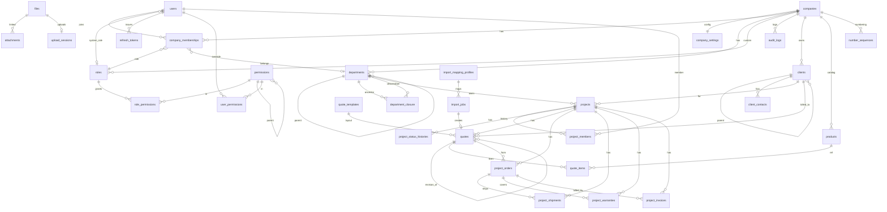

# 資料庫規劃

DDL 草稿見 [database-schema.sql](./database-schema.sql)；實作時以 EF Core entity + migration 為準，兩者必須同步更新。

**目前狀態**：第一階段的 12 張表（`users`、`refresh_tokens`、`companies`、`company_settings`、`departments`、`department_closure`、`company_memberships`、`roles`、`permissions`、`role_permissions`、`user_permissions`、`audit_logs`）已由 migration `InitialIdentity` 建立，entity 在 `apps/api/QuotePlatform.Api/Infrastructure/Entities.cs`。第二階段的 `clients`、`client_contacts`、`projects`、`project_members`、`project_status_histories`、`number_sequences` 由 migration `AddClientsAndProjects` 建立，entity 在 `Infrastructure/BusinessEntities.cs`。第三階段的 `quotes`、`quote_items`、`products`、`import_jobs`、`import_mapping_profiles` 由 migration `AddQuotesAndProducts` 建立，entity 在 `Infrastructure/QuoteEntities.cs`。第四階段的 `files`、`attachments`、`project_orders`、`project_warranties`、`project_invoices` 由 migration `AddProjectDocumentsAndFiles` 建立，entity 在 `Infrastructure/DocumentEntities.cs`。報價單格式所需的 `companies.EnglishName`、`company_settings.QuoteNumberPattern` 由 migration `AddQuoteBranding` 新增。出貨單 `project_shipments` 由 migration `AddProjectShipments` 建立。客戶所屬部門 `clients.DepartmentId` 與自訂角色建立者 `roles.CreatedBy` 由 migration `AddClientDepartmentAndRoleCreator` 新增。專案跟進紀錄 `project_followups` 與 `projects.LastFollowUpAt`、`projects.NextFollowUpOn` 由 migration `AddProjectFollowUps` 建立，entity 在 `Infrastructure/FollowUpEntities.cs`。草稿中的 `quote_templates` 與 `upload_sessions` 尚未建立。

第三階段與草稿的差異：`quotes` 多了 `NetAmount`（未稅金額，含稅報價時由總額反推）、`SubmittedBy／SubmittedAt`、`StatusReason`（退回或拒絕原因），沒有 `LastPdfFileId`（PDF 即時產生，不存檔）；`import_jobs` 多了 `FileName`，`FileId` 待第四階段檔案服務上線再保存原始檔；`quote_templates` 尚未建立。

第四階段與草稿的差異：
- 沒有 `upload_sessions`：改為單次上傳，上傳狀態直接記在 `files.Status`（uploading／ready／deleted）與 `CompletedAt`，有效期限由 token 控制。
- `attachments` 沒有 `SortOrder`，依建立時間排序。
- `project_invoices.Status` 只有 issued／void（折讓暫不處理），新增 `VoidReason`；收款以累計 `PaidAmount` 登記，`PaymentStatus` 由後端計算。
- 發票不做軟刪除：`(CompanyId, InvoiceNo)` 唯一索引會擋住重新登錄，因此只允許**未收款、未作廢**的發票實體刪除（快照留在 `audit_logs`），已開出的請作廢。訂單、出貨單、保固單為軟刪除；訂單底下還有開立中發票、出貨單或保固單時不可刪。
- 刪除附件只把 `files` 標為 deleted，儲存區的實體檔案保留供稽核，日後再以清理工作處理。

實作補充：

- `clients`、`projects` 實作 `ISoftDelete`；EF Core 每個 entity 只能有一個 query filter，因此軟刪除條件與公司條件合併為 `CompanyId == 目前公司 && !IsDeleted`。
- 單號由 `NumberSequenceService` 以 `INSERT … ON DUPLICATE KEY UPDATE CurrentValue = LAST_INSERT_ID(CurrentValue + 1)` 原子遞增（同一連線再 `SELECT LAST_INSERT_ID()`）；專案 `P{年}-{4 碼}` 每年重算，客戶 `C{4 碼}`。取號後寫入失敗會留下跳號，刻意接受。已驗證 8 筆併發建立不重號。
- 搜尋「建立日」以台灣時間（UTC+8，`BusinessTime`）切日換算成 UTC 區間；開工／完工日是 `DATE` 欄位直接比較。
- 專案狀態流程定義在 `ProjectStatuses.Transitions`：草稿→報價中→得標／未得標→執行中→已完工→已結案；未得標可重新報價（建立或送審報價時自動回到報價中）或直接改為得標、已取消可回到草稿；每次異動寫 `project_status_histories`。

## 1. 部署與隔離

- **不另建 MariaDB container**：沿用美達特的共用 MariaDB（Mac 為 `shared-mariadb`／`127.0.0.1:9529`，demo／VPS 為 `central-mariadb`），container 內以主機名稱 `mariadb` 連線，詳見 [system-architecture.md 第 9 節](./system-architecture.md#9-部署與資料庫連線沿用美達特-shared-db)。
- 在共用 MariaDB 上只建立本系統自己的資料庫 `quote_platform` 與帳號 `quote_app`（只授權 `quote_platform.*`）；**不得**連線或授權任何美達特 `metat_*` 資料庫。API 不持有 root 密碼。
- 備份只處理 `quote_` 開頭的資料庫；美達特的備份腳本只備 `metat_`，不會涵蓋本系統。
- 單一資料庫、多公司共用：所有業務表都有 `CompanyId`，由 JWT 的 `company_id` 決定範圍。
- EF Core：業務 entity 實作 `ICompanyOwned`，`QuoteDbContext` 對其設定 Global Query Filter `e.CompanyId == scope.CompanyId`；`SaveChanges` 攔截器在新增時填入 `CompanyId`、修改時拒絕變更 `CompanyId`。
- platform scope 的維運查詢要跨公司時，必須明確呼叫 `IgnoreQueryFilters()` 並寫 audit。

## 2. 命名與型別慣例（沿用美達特）

| 項目 | 慣例 |
|---|---|
| 表名 | 複數 snake_case，例如 `project_invoices` |
| 欄位 | PascalCase（對應 C# property） |
| 主鍵 | `Id CHAR(36)`（Guid） |
| 時間 | UTC，`DATETIME(6)`（C# `DateTimeOffset`） |
| 日期 | 業務日期（報價日、發票日）用 `DATE`（C# `DateOnly`） |
| 金額 | `DECIMAL(18,2)` |
| 數量、單價、匯率 | `DECIMAL(18,4)` |
| JSON | `LONGTEXT` + `JSON_VALID` 檢查 |
| 稽核 | `CreatedBy`、`CreatedAt`、`UpdatedBy`、`UpdatedAt` |
| 軟刪除 | 業務主檔 `IsDeleted`、`DeletedAt`；Global Query Filter 同時排除已刪除 |
| 索引 | 業務表的查詢索引一律以 `CompanyId` 開頭 |

## 3. ER 圖

## 4. 資料表

### 4.1 身分與權限

| 資料表 | 用途與主要約束 |
|---|---|
| `users` | 登入帳號。`Account` 唯一；`SystemRoleId` 只指向 platform role；`AuthVersion` 為 token 撤銷版本；`FailedLoginCount`、`LockedUntil` 供登入鎖定 |
| `refresh_tokens` | 只存 `TokenHash`（唯一）；`RevokedAt`、`ReplacedById` 支援輪替與重用偵測 |
| `companies` | 公司（美達特 customers）。`Slug` 唯一；`RootAdminMembershipId` 指向受保護的主管理員；`IsRoleCrudConfigurationEnabled`、`IsRoleOptionConfigurationEnabled` 同美達特；`EnglishName`、`Phone`、`Address`、`LogoFileId` 印在報價單抬頭（公司參數頁維護，Logo 檔案存在 `{companyId}/logo/{fileId}`，不建 attachment） |
| `company_settings` | 一對一：預設稅率、幣別、報價有效天數、預設條款（一條一行、不含編號）、PDF 表頭、會計年度起始月、報價單號規則 `QuoteNumberPattern`（預設 `Q{yyyy}{MM}-{seq:4}`） |
| `departments` | 部門樹（美達特 tenants），`ParentId` 自關聯 |
| `department_closure` | PK(`AncestorId`,`DescendantId`)，`Depth = 0` 為自身；索引(`AncestorId`,`Depth`)、(`DescendantId`,`Depth`) |
| `company_memberships` | 使用者在公司的身分。unique(`CompanyId`,`UserId`)；`DataScopeOverride` 可覆寫角色的資料範圍 |
| `roles` | `CompanyId` 為空表示系統內建；`Scope`、`DataScope`；unique(`CompanyId`,`Code`)。NULL 不觸發 unique，系統內建角色的 `Code` 唯一由 Seeder 與 Service 保證 |
| `permissions` | 權限目錄（同美達特 `PlatformPermission`）：`Code` 唯一、`ParentId` 樹、`RoutePath`、`IsMenu`、`SubFeaturesJson` |
| `role_permissions` | PK(`RoleId`,`PermissionId`)；`PerCreate/Read/Update/Delete`、`OptionsJson` |
| `user_permissions` | 個人權限。unique(`CompanyId`,`UserId`,`PermissionId`,`Effect`)；`Effect` = grant／deny；`ExpiresAt` 支援臨時授權 |
| `audit_logs` | `EntityType`、`EntityId`、`Action`、`BeforeJson`、`AfterJson`、`Ip`；索引(`CompanyId`,`EntityType`,`EntityId`)、(`CompanyId`,`CreatedAt`) |

### 4.2 客戶與品項

| 資料表 | 用途與主要約束 |
|---|---|
| `clients` | 客戶主檔。unique(`CompanyId`,`Code`)；索引(`CompanyId`,`TaxId`)、(`CompanyId`,`Name`)；`ParentClientId` 支援集團／分公司；`OwnerUserId` 為業務負責人；`DepartmentId` 為所屬部門（決定誰看得到，FK `departments` SET NULL，索引(`CompanyId`,`DepartmentId`)，既有資料由 migration 依負責人目前的部門回填，沒有負責人的歸公司最上層部門）；`InvoiceTitle`、`InvoiceAddress`、`PaymentTerms` 供報價與發票帶入 |
| `client_contacts` | 聯絡人，`IsPrimary` 為報價預設帶入對象 |
| `products` | 品項價目表，報價明細自動完成用；unique(`CompanyId`,`Code`) |

### 4.3 專案

| 資料表 | 用途與主要約束 |
|---|---|
| `projects` | unique(`CompanyId`,`ProjectNo`)。狀態 `draft`→`quoting`→`won`/`lost`→`in_progress`→`completed`→`closed`，另有 `cancelled`。`ExpectedAmount` 預估金額；`ContractAmount`／`ContractTotal` 由接受的報價回寫。搜尋索引：(`CompanyId`,`Status`,`CreatedAt`)、(`CompanyId`,`StartDate`)、(`CompanyId`,`EndDate`)、(`CompanyId`,`ContractAmount`)、(`CompanyId`,`ExpectedAmount`)、(`CompanyId`,`ClientId`)、(`CompanyId`,`DepartmentId`)、(`CompanyId`,`OwnerUserId`)。`LastFollowUpAt`、`NextFollowUpOn` 是依最新一筆跟進紀錄重算的快取（只由 FollowUpService 寫入），索引(`CompanyId`,`NextFollowUpOn`) 供下次聯絡排序與逾期篩選。 |
| `project_members` | PK(`ProjectId`,`UserId`)；`ProjectRole` = manager／member／viewer；索引(`CompanyId`,`UserId`) 供 `own` 資料範圍查詢 |
| `project_status_histories` | 狀態異動紀錄 |
| `project_followups` | 跟進紀錄（電話、拜訪、會議、Email、訊息、其他）；`Type` CHECK 限六種值；軟刪除。索引(`CompanyId`,`ProjectId`,`IsDeleted`,`OccurredAt`) 供專案內時間軸與「最新一筆」，(`CompanyId`,`OccurredAt`) 供跨專案總表。`ContactId` 刪除聯絡人時設為 NULL，`ContactName` 保留姓名快照 |

專案名稱關鍵字搜尋：資料量小時用 `LIKE`；之後可加 FULLTEXT（ngram parser 支援中文）。

### 4.4 報價

| 資料表 | 用途與主要約束 |
|---|---|
| `quotes` | unique(`CompanyId`,`QuoteNo`,`RevisionNo`)；索引(`CompanyId`,`ProjectId`)、(`CompanyId`,`Status`,`QuoteDate`)、(`CompanyId`,`AcceptedAt`)。保存客戶快照、折扣、稅別（應稅／零稅率／免稅、含稅或外加）、小計、稅額、總計、成本與毛利；`Source` 記錄來源；`IsLatest` 標示最新版 |
| `quote_items` | 明細。`LineType` = item／section／subtotal／note；`Amount` 由後端重算；`UnitCost` 只在有 `view_cost` 時回傳 |
| `quote_templates` | PDF／Excel 範本設定，`TemplateFileId` 指向 Excel 範本檔 |
| `import_jobs` | Excel 範本、舊報價、OCR 共用的兩階段匯入工作；`PreviewJson` 存解析結果供修正 |
| `import_mapping_profiles` | 舊報價格式對照：工作表、表頭列、資料起始列、欄位對照、表頭儲存格對照 |
| `number_sequences` | PK(`CompanyId`,`DocType`,`Period`)；交易內 `SELECT … FOR UPDATE` 遞增取號。報價的 `Period` 依單號規則最細的日期代號（`yyyyMMdd`／`yyyyMM`／`yyyy`／`all`），改規則後產生的號碼若已存在會跳號重試 |

報價規則（實作見 `Modules/Quotes/QuoteService.cs`、`Infrastructure/QuoteCalculator.cs`）：

1. `draft`、`rejected` 可修改；`pending_approval` 起鎖定。
2. 改版：複製為新草稿，版次取同單號曾用過的最大版次 + 1（已刪除的版次不重複使用，因為有唯一索引）；`RevisionOfId` 指向前版，前版 `IsLatest = 0` 但狀態不變，等新版送審時才改為 `superseded`；刪除尚未送審的新版會把前版恢復為最新。
3. 接受：同專案其他有效報價改 `superseded`；回寫 `projects.ContractAmount`、`ContractTotal`、`WonAt`，專案改 `won`。
4. 稅額計算：外加 `TaxAmount = round(未稅 × 稅率)`；含稅時 `未稅 = round(總額 ÷ (1 + 稅率))`、`稅額 = 總額 − 未稅`。新台幣算到元、其他幣別兩位小數，四捨五入採 AwayFromZero。前端編輯器以相同公式即時試算（`src/shared/utils/quote-calc.ts`），存檔以後端為準。
5. 建立第一張報價時，草稿專案自動改為「報價中」。
6. 沒有 `quotes:view_cost` 的人：API 不回傳成本與毛利，送來的成本也不會寫入。

### 4.5 訂單、出貨、保固、發票

層級為「定案報價 → 訂單 → 出貨單／發票／保固單」。新增時 `QuoteId`、`OrderId` 必填由 API 檢查；`project_orders.QuoteId`、`project_invoices.OrderId`、`project_warranties.OrderId` 仍為 NULL 欄位，保留規則上線前沒有對應的舊資料。

| 資料表 | 用途與主要約束 |
|---|---|
| `project_orders` | 每專案多筆；`QuoteId` 對應定案（已接受）報價，新增時必填；`OrderNo` 存客戶 PO 號；索引(`CompanyId`,`OrderDate`)、(`CompanyId`,`ProjectId`) |
| `project_shipments` | 每張訂單可分批出貨；`OrderId` 必填（NOT NULL，FK RESTRICT）；`Status` shipped／delivered／cancelled；收貨人、送貨地址、物流單號；軟刪除；索引(`CompanyId`,`ProjectId`)、(`CompanyId`,`OrderId`) |
| `project_warranties` | 每專案多筆；`OrderId` 對應訂單，新增時必填；索引(`CompanyId`,`EndDate`) 供到期提醒 |
| `project_invoices` | 每專案多筆；unique(`CompanyId`,`InvoiceNo`)；`InvoiceType` 二聯／三聯／電子；`Status` issued／void／allowance；`PaymentStatus`、`PaidAmount`、`DueDate`、`PaidAt`；索引(`CompanyId`,`InvoiceDate`)、(`CompanyId`,`PaymentStatus`,`DueDate`) |

### 4.6 檔案

| 資料表 | 用途與主要約束 |
|---|---|
| `files` | 檔案 metadata，本體在 MinIO；`StorageKey` 唯一 |
| `upload_sessions` | 同美達特 `media_upload_sessions`，chunk 清單只存在 file-server 的 manifest |
| `attachments` | 多型關聯：`OwnerType` = project／quote／order／warranty／invoice／client，`OwnerId` 為對應 Id；索引(`CompanyId`,`OwnerType`,`OwnerId`)。因為多型無法建 FK，由 Service 驗證 Owner 存在且在資料範圍內 |

### 4.7 虛擬辦公室

| 資料表 | 用途與主要約束 |
|---|---|
| `office_rooms` | 部門辦公室設定（目前只有主題）；unique(`CompanyId`,`DepartmentId`)；管理員第一次設定主題時建立，沒有資料列時主題視為 `wood` |
| `office_profiles` | 成員的角色外觀、手動狀態、狀態文字與最後在線時間；unique(`MembershipId`)；`Status` CHECK 限五種值。走動、表情、聊天、上線狀態本身只存在 API 記憶體，不寫資料庫 |

## 5. Dashboard 查詢依據

| 指標 | 來源 | 時間欄位 |
|---|---|---|
| 報價接受金額 | `quotes` where `Status = accepted` | `AcceptedAt` |
| 接單金額 | `project_orders` where `Status <> cancelled` | `OrderDate` |
| 開票金額 | `project_invoices` where `Status <> void` | `InvoiceDate` |
| 收款金額 | `project_invoices.PaidAmount` | `PaidAt` |
| 案件數 | `projects` 依 `Status` 分組；新增數依 `CreatedAt` | `CreatedAt` |
| 成交率 | `won ÷ (won + lost)` | `WonAt`／`ClosedAt` |
| 到期保固 | `project_warranties` | `EndDate` |
| 未收款 | `project_invoices` where `PaymentStatus <> paid` | `DueDate` |

全部先 join `ProjectAccessService.VisibleProjects()` 套資料範圍。資料量變大後新增 `monthly_sales_snapshots`（`CompanyId`、`Year`、`Month`、`DepartmentId`、`OwnerUserId`、各指標金額）由排程每日重算當月。

## 6. Seeder

- `QuoteSeeder` 必須 idempotent：權限目錄、系統角色（`platform-admin`、`company-admin`、`sales-manager`、`sales`、`accountant`、`viewer`）與其 `role_permissions`。
- Development 才建立示範公司、部門、帳號與 `admin` 系統帳號。
- 新增公司（onboarding）：同一交易建立 `companies`、`company_settings`、根部門與其 closure、第一位 `company-admin` membership，並回寫 `RootAdminMembershipId`。
