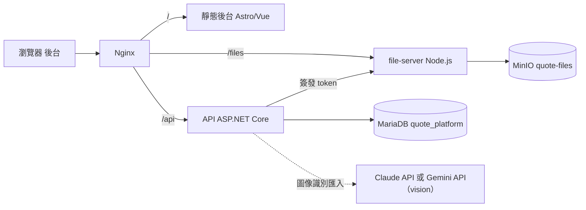

# 系統架構

## 1. 設計來源與差異

本系統以美達特多站台管理系統（`../美達特官網`）為參考：

| 項目 | 美達特 | 本系統 |
|---|---|---|
| 租戶 | 商家（customer），每商家一個 customer database | 公司（company），**共用單一資料庫**，每列 `CompanyId` 隔離 |
| 商家節點樹 | `tenants` + `tenant_closure` | 轉為**部門樹** `departments` + `department_closure`，用於資料範圍 |
| 商家資料 | 商家即登入租戶 | 拆出**客戶（client）**：報價對象資料，不登入 |
| 權限 | 角色 × 資源 × CRUD × 子功能 | 沿用，並新增**個人權限**與**資料範圍** |
| Token | access token 重簽 | access token + 可撤銷、可輪替的 refresh token |
| 媒體 | media-server + MinIO | file-server（精簡版）+ **獨立** MinIO bucket |

## 2. Repo 結構

```
專案報價管理系統/
├─ apps/api/QuotePlatform.Api/      ASP.NET Core 10 modular monolith（Controller → Service → DbContext）
│   ├─ Infrastructure/               QuoteDbContext、JwtTokenService、PermissionGrantService、CompanyScope、Seeder
│   └─ Modules/
│       ├─ Identity/                 登入、refresh、/auth/me、/auth/menu、切換公司
│       ├─ Administration/           公司、部門、帳號、角色、權限目錄、個人權限
│       ├─ Clients/                  客戶、聯絡人
│       ├─ Projects/                 專案、成員、搜尋
│       ├─ Quotes/                   報價單、明細、版本、編號、PDF、Excel 匯入匯出、OCR
│       ├─ ProjectDocuments/         訂單、出貨單、保固單、發票
│       ├─ Files/                    檔案 metadata、上傳 session、簽章下載 token
│       └─ Dashboard/                業績統計
├─ apps/web/                         Astro static + Vue 3 islands（單一後台 APP_ID=admin）
├─ file-server/                      chunk upload、MinIO、signed token
├─ packages/contracts/               OpenAPI
├─ infra/                            nginx、MinIO 設定（MariaDB 沿用共用 container，不另建）
└─ docs/
```

## 3. 執行元件



| 元件 | 說明 |
|---|---|
| Nginx | 單一入口：`/` 後台靜態檔、`/api` → API、`/files` → file-server |
| API | JWT 驗證、授權、業務邏輯、PDF／Excel 產生、Dashboard 聚合。另提供 SignalR hub `/api/hubs/office`（虛擬辦公室），上線狀態只存在記憶體，限單一實例；多實例時需加 Redis backplane。 |
| file-server | 沿用美達特 `media-server/src/token.mjs`、`upload-manifest.mjs`、`range.mjs` 的機制；API 簽發上傳／下載 token，file-server 只驗 token 不讀資料庫 |
| MariaDB | **沿用美達特的共用 MariaDB**（`DB_MODE=shared`，見第 9 節）；本系統只用自己的資料庫 `quote_platform` 與帳號 `quote_app`，不碰任何 `metat_*` 庫 |
| MinIO | 獨立 bucket `quote-files`、獨立 access key；物件 key：`{companyId}/{yyyy}/{MM}/{fileId}` |

## 4. 關鍵套件

- Excel 讀寫：ClosedXML 0.105（只支援 .xlsx；舊版 .xls 需先另存）
- PDF：QuestPDF 2026.9（Community 授權，年營收低於 100 萬美元免費，超過需購買商業授權）。2026.9 起預設不讀系統字型且缺字型會直接報錯；目前開啟 `UseSystemFonts`，Docker 映像安裝 `fonts-noto-cjk`（Noto Sans CJK TC），Mac 開發機使用蘋方／黑體。也可用 `Quote__PdfFontDirectory` 指定放 .ttf／.otf 的目錄。QuestPDF 官方建議把字型檔隨程式部署；Noto Sans TC 為 SIL OFL 授權可再散布，但目前尚未下載放入 repo
- 圖表：ECharts（vue-echarts）
- 前端版本：Astro 7.4 + `@astrojs/vue` 7.1 + Vue 3.5.44 + Ant Design Vue 4.2 + TanStack Table 9.3（`@tanstack/vue-table`，表格狀態）+ TanStack Query，需要 **Node 24**（根目錄 `.nvmrc`）。比美達特的 Astro 5 新，因為 Astro 5.x 有多個已公告的安全性問題（`npm audit` 會列出），新專案直接從修正後的版本開始。
- `MySqlConnector` 明確鎖在 2.6.2：Pomelo 9.0.0 預設帶入的 2.4.0 有 GHSA-473q-m89c-ghf8。
- OCR：Claude API（官方 C# SDK `Anthropic`，預設 `claude-opus-5-5`）或 Gemini API（REST `generateContent`，預設 `gemini-3.8-flash`），以 vision 讀圖片／PDF、structured output 回傳 JSON，接到與 Excel 匯入相同的預覽流程

## 5. 可沿用的美達特程式

| 美達特 | 用途 |
|---|---|
| `apps/api/Platform.Api/Infrastructure/SecurityAndProvisioning.cs` 的 `RequestScope`、`JwtTokenService`、`PermissionGrantService`、`PermissionGrant` | scope 改為 `platform`／`company`，claim 改 `company_id`、`department_id`、`data_scope` |
| `Infrastructure/PlatformSeeder.cs` | 權限目錄的 idempotent seed |
| `Infrastructure/CustomerRolePermissionCeilingRules.cs` | 公司角色不得超過 `company-admin` 上限 |
| `Modules/Identity/LoginAttemptGuard.cs`、`LoginCaptchaService.cs` | 登入鎖定、驗證碼 |
| `Modules/Common/Controllers/CustomerScopeControllerBase.cs` | 改為 `CompanyScopeControllerBase` |
| `Modules/Platform/MerchantStructureService.cs` + `tenant_closure` | 轉為部門樹 |
| `apps/web/src/apps/auth/components/AuthGate.vue`、`PermissionGate.vue`、`LoginPage.vue` | 前端授權 gate |
| `apps/web/src/apps/cms/route-manifest.ts`、`layouts/CmsLayout.vue`、`src/shared/services/auth-service.ts`、`auth-session.ts` | 路由權限 manifest、版面、token 管理 |
| `media-server/` | 精簡為 file-server |

## 6. 主要流程

### 6.1 報價單建立

1. 在專案內新增報價單（或從專案列表選專案）。
2. 選擇客戶：帶入客戶名稱、統編、地址等**快照**與主要聯絡人。
3. 輸入明細：可從 `products` 價目表自動完成，支援分段標題、小計列、備註列。
4. 存檔時後端重算小計、折扣、稅額、總計與毛利。
5. 草稿 → 送審（具 `quotes:approve` 的人核准）→ 匯出 PDF（存成檔案並更新 `LastPdfFileId`）→ 標記已送出 → 已接受／已拒絕。
6. 已接受時回寫專案的成交金額，專案狀態改為 `won`，同專案其他進行中的報價改為 `superseded`。每個專案只能有一份定案（已接受）報價：已有定案時，接受第二份會被拒絕。
7. 已送出的報價要修改時，只能「改版」：複製出 `RevisionNo + 1` 的新草稿，舊版標示 `superseded`。

### 6.2 匯入（Excel 範本／舊報價 Excel／圖像識別）

三種來源共用 `import_jobs` 兩階段流程，避免解析錯誤直接寫進正式資料：

1. 上傳檔案 → 建立 `import_jobs`（`uploaded`）。
2. 解析 → 結果寫入 `PreviewJson`（`preview`），錯誤寫入 `ErrorsJson`。
   - Excel 範本：系統提供的標準範本，欄位固定。
   - 舊報價 Excel：以 `import_mapping_profiles` 指定工作表、表頭列、資料起始列與欄位對照，可存多套格式；不指定對照時自動辨識表頭列與欄位。表頭標籤會先去掉括號說明再比對（例：「單價(NT$)」），並辨識「公司名」「專案」「Ref. No.」等常見寫法。檔案沒有「備註條款」欄位時，從明細下方找出含條列編號的連續區塊當作條款（隔著空白列的簽章欄不會被誤抓），條款格式見 6.7。
   - 圖像識別：照片、掃描圖或 PDF 交給 Claude 或 Gemini 抄錄，再轉成與 Excel 相同的預覽格式（見 6.6）。
3. 前端以預覽表格讓使用者修正，可指定要匯入的專案與客戶。
4. 確認 → 在同一交易內建立 quote 與 items（`confirmed`），`quotes.Source` 記錄來源。

### 6.3 訂單、出貨、保固、發票

單據層級：

```
客戶 ─1:N→ 專案 ─1:N→ 報價單（含改版，只有一份定案）
                         └ 定案報價 ─1:N→ 訂單（客戶 PO）
                                            ├ 1:N → 出貨單（可分批出貨）
                                            ├ 1:N → 發票
                                            └ 1:N → 保固單
```

- 新增訂單必須對應同專案**已接受**的報價（`QuoteId`）。
- 新增出貨單、發票、保固單必須對應同專案**未取消**的訂單（`OrderId`）。
- 這些規則由 API 檢查；資料表欄位仍可為 NULL，規則上線前建立、沒有對應的舊資料，編輯時可以維持空白（出貨單是新功能，一律必填）。
- 訂單底下還有開立中的發票、出貨單或保固單時不能刪除。
- 出貨單沿用 `orders` 權限（出貨是訂單履約的一部分）。

每種單據都可附多個檔案（`attachments`）；發票另外記錄收款狀態（部分收款、已收款、逾期）。上傳流程：

1. 前端向 API 申請上傳（`POST /api/files/upload-sessions`），API 依所屬對象檢查權限與資料範圍、副檔名與大小（20 MB 內），建立 `files`（`uploading`）與 `attachments`，回傳 file-server 網址與 15 分鐘有效的上傳 token。
2. 前端把檔案**單次** PUT 到 file-server（`/files/uploads/{fileId}`）。file-server 邊收邊算 SHA-256、核對大小與檔頭（PDF、PNG、JPEG、WebP、HEIC、xlsx、docx），存入檔案系統或 MinIO。
3. file-server 以共享密鑰回呼 API（`/api/internal/files/{id}/completed`），API 標示 `ready`；回呼失敗時 file-server 刪除剛存的檔案，不留孤兒檔。
4. 下載時 API 再檢查一次權限，簽發 5 分鐘有效的下載連結（`/files/objects/{fileId}?token=…`），支援 Range 與中文檔名。

與美達特 media-server 的差異：不做分段（chunk）上傳。專案附件多為數 MB 的掃描檔，單次上傳較簡單；token 格式、Range 與 storage 介面沿用美達特，需要時可再加入美達特的 upload-manifest 分段機制。

### 6.4 Dashboard

`GET /api/dashboard/summary?year=&metric=accepted|orders|invoiced&departmentId=&ownerUserId=`（需 `dashboard:read`）

先用 `ProjectAccessService.VisibleProjects` 套用目前使用者的資料範圍，再聚合：業務只看到自己的業績，主管看到部門，全公司範圍看到全部。目前在記憶體彙總「本會計年度＋去年度」的資料列；資料量變大時再加 `monthly_sales_snapshots` 月結快照表。

- 業績口徑可切換，**一律為未稅金額**：
  - **報價接受**（`accepted`）：`quotes.Status = accepted` 的 `NetAmount`，依 `AcceptedAt`（台灣時間）歸月
  - **接單**（`orders`）：`project_orders.Amount`，排除 `cancelled`，依 `OrderDate`
  - **開票**（`invoiced`）：`project_invoices.SalesAmount`，只算 `issued`（排除作廢），依 `InvoiceDate`
- 會計年度：`year` 為會計年度（以起始月所在的西元年命名），起始月取自 `company_settings.FiscalYearStartMonth`；季度是會計年度的第 1～4 季
- 回傳：12 個月趨勢與去年同月、4 季與去年同季、年度累計／去年同期／成長率、本季、本月、三種口徑的年度合計
- 案件數：各狀態專案數、進行中案件、本年度新增（含每月）、成交率（本年度得標 ÷（得標＋未得標），未得標以狀態紀錄判斷）
- 業務排行（前 10 名，需 `dashboard:view_all_staff`）
- 90 天內到期的保固（需 `warranties:read`）、未收款發票與逾期（需 `invoices:read`）
- 沒有 `dashboard:view_amount` 時所有金額為 `null`，前端只顯示件數
- `departmentId` 篩選含下層部門，且仍受資料範圍限制；`ownerUserId` 篩選專案負責人

前端（首頁）：篩選列（年度、口徑、部門、負責人）、KPI 卡片、月趨勢折線（今年 vs 去年，十字線提示框，可切換成表格檢視）、季度長條、案件狀態與業務排行橫條、應收帳款與到期保固表。圖表用 ECharts（只註冊折線、長條、格線、圖例、提示框與 SVG renderer），配色與樣式集中在 `apps/web/src/shared/utils/chart-theme.ts`。

### 6.5 公司參數

`GET|PUT /api/admin/settings`（`company.settings` 的 read／update）：預設稅率、幣別、報價有效天數、報價預設條款（條列編輯）、報價單號規則（附下一張範例 `quoteNumberPreview`）、會計年度起始月，以及報價單抬頭（英文名稱、電話、地址、Logo）。公司名稱、統編由平台管理維護，這裡只顯示。後台頁面為 `/admin/settings`；條款、單號規則與抬頭細節見 6.7。

### 6.6 圖像識別匯入（第六階段）

照片、掃描圖（JPG／PNG／WebP／GIF，5 MB 內）或 PDF（10 MB 內）由 API 呼叫 Claude 或 Gemini 辨識，結果轉成與 Excel 匯入相同的 `ParsedQuote`，之後的「預覽 → 修正 → 建立草稿」完全共用。共用部分（指示文字、結果結構、轉換與檢查）在 `Modules/Quotes/QuoteOcr.cs`，兩家的串接在 `Modules/Quotes/QuoteRecognizers.cs`（`IQuoteRecognizer`）。

- **AI 設定檔**：供應商、模型與強度放在 `apps/api/QuotePlatform.Api/ai-settings.json`（部署時是 `deploy/config/ai-settings.json`，docker-compose 掛載到 `/app/config`）。檔案可寫 `//` 註解，存檔後幾秒內自動生效，不需重啟；值寫錯時 API 記錄錯誤並沿用上一份正確設定，啟動時寫錯則無法啟動。路徑可用 `Quote__AiSettingsPath` 改；環境變數 `Ai__Ocr__...`（例如 `Ai__Ocr__Provider=gemini`）會覆寫檔案內容。程式在 `Infrastructure/AiOptions.cs`（`AiSettings`）。

  ```jsonc
  {
    "Ai": {
      "Ocr": {
        "Provider": "",                                                  // claude、gemini，或空字串（自動）
        "Claude": { "Model": "claude-opus-5-5", "Effort": "medium" },          // medium、high、xhigh、max
        "Gemini": { "Model": "gemini-3.8-flash", "ThinkingLevel": "medium" }  // medium、high
      }
    }
  }
  ```

- **選擇供應商**：`Provider` 留空時自動選有設定金鑰的一家，兩家都有時用 Claude。選定的供應商沒有金鑰時功能關閉：`GET /api/quote-imports/options` 回 `ocrEnabled: false`，前端不顯示「照片／掃描檔」；啟用時回傳 `ocrProvider`，畫面會告知檔案送往哪一家。

  | 項目 | Claude | Gemini |
  |---|---|---|
  | 金鑰（環境變數，機密） | `Quote__AnthropicApiKey`（compose：`ANTHROPIC_API_KEY`） | `Quote__GeminiApiKey`（compose：`GEMINI_API_KEY`） |
  | 模型（設定檔） | `Ai:Ocr:Claude:Model`，預設 `claude-opus-5-5` | `Ai:Ocr:Gemini:Model`，預設 `gemini-3.8-flash` |
  | 強度（設定檔） | `Ai:Ocr:Claude:Effort` → 請求的 `output_config.effort`，預設 `medium` | `Ai:Ocr:Gemini:ThinkingLevel` → `generationConfig.thinkingConfig.thinkingLevel`（送出時轉大寫），預設 `medium` |
  | 位址（僅代理或本機模擬，環境變數） | `Quote__AnthropicBaseUrl` | `Quote__GeminiBaseUrl` |

  **強度下限為 medium**：辨識報價單需要逐列核對數字，強度太低容易漏列或抄錯，因此 Claude 不開放 `low`、Gemini 不開放 `minimal`／`low` 與「模型預設」（有些模型預設是 `minimal`）。設定低於下限時，啟動會失敗、執行中修改則沿用上一份設定。強度越高辨識越仔細，但越慢、費用越高。模型本身不限制；換成不支援某強度的模型時，供應商會回錯誤，使用者看到「這個檔案無法辨識」，API 記錄檔會留下原因。稽核紀錄（`audit_logs`）記下每次辨識使用的供應商、模型與強度。

- **結構只定義一次**：`OcrSchema` 定義一份欄位結構，再分別輸出 Claude 的 JSON Schema（`["string","null"]`、`additionalProperties: false`）與 Gemini 的 OpenAPI 子集（型別大寫、`nullable: true`、`propertyOrdering`，不支援 `additionalProperties`）。所有欄位都列在 required，可缺的值以 null 表示。
- **權限**：`quotes:create` ＋ `quotes:import_ocr`（內建角色中業務、業務主管、公司管理員有）。
- **Claude 請求**：官方 C# SDK（`Anthropic` 13.x）呼叫 beta Messages API；API key 由 SDK 放在 `Authorization: Bearer`（API 版本 2026-10-21）。圖片用 base64 `image` 區塊、PDF 用 `document` 區塊；`output_config.format` 為 JSON schema，`effort: medium`；模型支援時加上 `fallbacks: "default"`（beta `server-side-fallback-2026-07-01`），被安全機制拒絕時由伺服器改用其他模型重試。
- **Gemini 請求**：`POST /v1beta/models/{model}:generateContent`，金鑰放 `x-goog-api-key` header（不放網址，避免進記錄檔）。`systemInstruction` 放指示文字，圖片與 PDF 以 `inlineData`（`mimeType`、base64 `data`）送出；`generationConfig.responseMimeType = application/json` 加 `responseSchema`，`maxOutputTokens` 32768。注意：Gemini API discovery 文件（revision 20261028）已把 `responseSchema` 標為 deprecated（建議改用 `response_format`），目前仍可使用；之後若停用，需改為新的欄位。回應取 `candidates[0].content.parts[].text`（略過 `thought` 部分）；`promptFeedback.blockReason` 或沒有候選結果視為拒絕，`finishReason` 為 `MAX_TOKENS` 視為太長，STOP 以外的其他原因（SAFETY、RECITATION…）視為拒絕。金鑰錯誤可能回 400（`API_KEY_INVALID`）或 401／403。
- **逾時與重試**：兩家都是 150 秒、連線錯誤與 5xx 重試 1 次；nginx 對 `/api/quote-imports` 放寬到 330 秒。
- **轉換與檢查**：日期（含民國年）、稅別、整單折扣沿用 Excel 匯入的 `QuoteExcel.NormalizeHeader`。「一式」只有金額的列以金額當單價。以下情況列入提醒，不擋匯入：模型標示看不清楚的列、數量 × 單價與文件金額不符、明細加總與文件小計不符、文件不像報價單，以及模型寫的備註。
- **失敗**：不支援的格式（HEIC 請先轉 JPG）、檔頭與副檔名不符、過大的圖片在呼叫供應商前擋下；供應商拒絕、金鑰無效、忙碌、內容過長、結果無法解析、沒有辨識到品項都回傳繁中訊息（兩家文字相同），`import_jobs` 記為 `failed`。
- **資料與費用**：檔案只在該次請求送給選定的供應商（Anthropic 或 Google），系統不另外保存原圖（預覽時的原圖只在使用者瀏覽器）。每次辨識依該供應商的 API 用量計費。Gemini 建議使用付費方案的金鑰：依 Google 條款，免費方案送出的內容可能被用於改善產品，而報價單含客戶名稱與金額。
- **金額仍由後端計算**：模型抄錄的金額只用來比對產生提醒；建立報價時一律以數量、單價、折扣重算。

### 6.7 報價單格式（條款、單號、抬頭、PDF 分頁）

**條款**（`Modules/Quotes/QuoteTerms.cs`）
- 儲存格式：`quotes.Terms`、`company_settings.DefaultTerms` 都是「一條一行、不含編號」，編號由畫面、PDF、Excel 匯出時產生，刪除或排序後不會亂號。
- Excel 匯出：每一條條款各佔一列（第一列標「備註條款」，合併 B～J 欄、自動換行，依字數估算列高）；匯入時把「備註條款」標籤下方、標籤欄空白的續列都併成條款，所以匯出再匯入條款不變。舊版「全部條款寫在同一格」的檔案也能匯入。
- 所有輸入（表單儲存、公司預設條款、Excel 匯入、圖像識別）都經 `QuoteTerms.Normalize`：辨識並移除行首編號（`1.`、`1、`、`1)`、`(1)`、`一、`、`(一)`、`•`、`●`、`- ` 等），有編號時把沒有編號的行併回上一條（Excel 為了換行拆成兩列的續行），沒有任何編號時每行一條；第一條之前的「備註條款」「說明事項」等標題行略過；最多 100 條。
- `POST /api/quote-terms/normalize`（`{ text }` → `{ items }`）：前端貼上整段文字時用同一套規則拆條，畫面與後端結果一致。
- 前端 `app/components/TermsEditor.vue`：一條一列、可新增／刪除／上下移動；在任一列貼上多行文字會自動拆成多條（該列空白則取代，否則接在後面），另有「整段貼上」取代全部或加在後面。用在報價編輯頁、匯入預覽、公司參數的預設條款。

**報價單號規則**（`Infrastructure/DocumentNumberPattern.cs`，設定在 `company_settings.QuoteNumberPattern`，預設 `Q{yyyy}{MM}-{seq:4}`）
- 代號：`{yyyy}`、`{yy}`、`{MM}`、`{dd}`、`{seq}`／`{seq:n}`（流水號補到 n 碼）。必須剛好一個流水號；其他文字只能用英數字與 `- _ / .`；規則最多 40 字、產生的單號最多 50 字。
- 流水號依規則中最細的日期代號重新起算：有 `{dd}` 每天、有 `{MM}` 每月、只有年份每年，都沒有則不重設（`number_sequences.Period` 為 `yyyyMMdd`／`yyyyMM`／`yyyy`／`all`）。日期用報價日期。
- 改規則後若產生的號碼已被使用（例如改回舊格式），取號會自動跳過，最多重試 20 次。

**報價單抬頭**：`companies.EnglishName`、`Phone`、`Address`、`LogoFileId` 由公司參數頁維護（公司名稱、統編仍由平台管理）。Logo 經 `POST /api/admin/settings/logo-upload` 申請上傳（PNG／JPG／WebP、2 MB 內，檔案存在 `{companyId}/logo/{fileId}`、不建立 attachment），上傳完成後以 `PUT /api/admin/settings` 的 `logoFileId` 套用、`removeLogo: true` 移除。產生 PDF 時 API 以 `Quote__FileServerInternalUrl`（compose 內為 `http://file-server:5190`）走內網向 file-server 取檔，快取 1 小時；取不到或不是有效圖片時記錄警告並略過 Logo，PDF 照常產生。

**PDF 版面與分頁**（`Modules/Quotes/QuotePdf.cs`，A4 直式）
- 抬頭：Logo、公司名稱、英文名稱、統編與電話、地址；右側「報 價 單」、單號、版次。明細欄位：項次、品名（含規格）、單位、數量、單價、金額，有任一列備註時才加備註欄。
- 先以一般版面產生；超過一頁時改用緊湊版面（字級 9、邊界與列距較小）重算，頁數較少才採用，讓剛好多出一點的報價收回一頁。
- 分頁規則：明細列不跨頁拆開；分段標題至少帶著下一列；合計區不拆開；條款的標題與第一條在一起，每條以懸掛縮排排版；最後兩個區塊與簽章欄綁在一起，避免最後一頁只剩簽章。
- 頁尾：單號、版次、第 x / y 頁。以 6–50 筆明細、12 條條款掃描驗證：12–13 筆一頁、40 筆兩頁，沒有拆開的列或只剩簽章的頁。

### 6.8 部門虛擬辦公室

- 規格：`docs/superpowers/specs/2026-11-03-virtual-office-design.md`。
- `Modules/Office/`：`OfficeMapGenerator`（依部門成員產生地圖）、`OfficeRules`（移動、聊天範圍、頻率限制）、`PresenceTracker`（記憶體上線狀態）、`OfficeHub`（SignalR）、`OfficeSweeper`（每 5 秒處理閒置／離線，每 `Quote__OfficeAuthSweepSeconds` 秒比對 AuthVersion）。
- hub 以 query `access_token` 驗證（僅此路徑），連線時要求 `office:read`；公司隔離靠群組 `company:{id}`、`office:{companyId}:{departmentId}`。hub 與背景巡檢沒有可靠的 HttpContext，資料庫存取前由 `OfficeService.UseCompany`（轉呼叫 `CompanyContext.UseCompany`）明確指定連線身分的公司。
- 長連線不會每個請求重新驗證 JWT，由 `OfficeSweeper` 定期比對 `users.AuthVersion`、帳號、成員身分與公司狀態，並開啟 `CloseOnAuthenticationExpiration` 讓連線在 access token 到期時關閉。兩種結果：帳號、成員身分或公司停用 → 送 `ForceDisconnect`，前端登出且不重連；只有 `AuthVersion` 變動（改角色權限、部門等）→ 送 `ReauthRequired`，前端強制換發 token、重新讀取權限後重連，不登出（與 REST 收到 401 的行為一致）。
- 走動、表情、聊天、上線狀態不寫資料庫；`office_rooms` 存主題、`office_profiles` 存角色、手動狀態與最後在線時間。上線狀態只在 API 記憶體，限單一實例；多實例時需加 SignalR Redis backplane。
- Nginx 另設獨立的 `location /api/hubs/`（`infra/nginx/default.conf`）：WebSocket upgrade、`access_log off`（token 在 query string）。
- 既有公司角色的 `office:read` 由 Seeder 一次性補上，部署此版本時必須執行一次 Seeder（見 `docs/permissions-and-data-scope.md` 3.2）。

### 6.9 專案跟進紀錄

- 規格：`docs/superpowers/specs/2026-11-04-project-followups-design.md`。
- `project_followups` 掛在專案下（電話、拜訪、會議、Email、訊息、其他），可見範圍完全繼承專案：主管依資料範圍看得到部屬專案的紀錄，判斷依據是專案所屬部門。寫入需要 `followups` CRUD 加專案寫入身分；已結案專案只能讀。
- 「最新一筆」依 `OccurredAt`（同時間比 `CreatedAt`）判斷，補登較早的紀錄不會蓋掉後來的下次聯絡。`projects.LastFollowUpAt`、`projects.NextFollowUpOn` 是依最新一筆重算的快取，只由 `FollowUpService` 在同一交易內以單一 `ExecuteUpdateAsync`（UPDATE + 子查詢）寫入；InnoDB 對子查詢加鎖讀取，同專案同時寫入不會算出過期狀態。寫了新的一筆，前一筆的待辦自然結束；「不用跟進」只作用在最新一筆。
- 待跟進不含未得標、已結案、已取消的專案（日期保留）；逾期以台灣時間的今天為準。
- API：`GET /api/followups`（跨專案總表）、`GET|POST /api/projects/{id}/followups`、`GET /api/projects/{id}/followups/contacts`（以專案範圍授權，因客戶依客戶部門判斷可見範圍）、`PUT|DELETE /api/followups/{id}`、`POST /api/projects/{id}/followups/dismiss-next`；專案列表支援 `followUp=pending|overdue|none` 與 `sort=nextFollowUpOn|lastFollowUpAt`。沒有 `followups:read` 時專案的跟進欄位為 null，篩選與排序被忽略。
- 前端：專案詳細頁「跟進紀錄」頁籤（`tab=followups` 可直接開啟）、專案列表「下次聯絡」欄與跟進狀態篩選、`/followups` 總表頁。
- 既有角色的 `followups` 由 Seeder 一次性補上，部署此版本時必須執行一次 Seeder（見 `docs/permissions-and-data-scope.md`）。

## 7. 主要 API

### 7.0.1 表格元件（DataTable）

全站表格共用 `apps/web/src/app/components/DataTable.vue`：**TanStack Table v9 管理狀態**（排序、分頁、展開、欄位定義），**畫面與樣式集中在這個元件**，主題色、邊框等取自 Ant Design 的 theme token，所以跟著 `a-config-provider` 走。分頁器沿用 Ant Design 的 `a-pagination`。

| 需求 | 用法 |
|---|---|
| 欄位 | `dataColumns<Row>()` 建立：`col.accessor('name', { header, enableSorting, meta: { width, align, fixed } })`、`col.display({ id: 'actions', header: '' })`；巢狀欄位用 `col.accessor((row) => row.client.name, { id: 'client', header })` |
| 後端分頁 | `:pagination="{ page, pageSize, total, showSizeChanger, showTotal }"`，`@change` 收到 `{ page, pageSize, sort, desc }` 後重新查詢 |
| 後端排序 | 欄位加 `enableSorting: true`，`:sorting="[{ id, desc }]"` 顯示目前排序；整個表頭儲存格可點，鍵盤用裡面的按鈕 |
| 自訂儲存格 | `#cell="{ columnId, record, value, index }"`；沒輸出內容的欄位自動顯示欄位值 |
| 展開列 | 提供 `#expanded="{ record }"` slot，每列左邊出現展開鈕（訂單、出貨、保固、發票的附件） |
| 勾選列 | `v-model:selected-keys`（列的 row-key 陣列）：左邊出現勾選欄，表頭可勾整頁；已勾選的 key 由頁面保留，可跨頁勾選；`row-selectable` 決定哪些列不能勾（選專案成員的名單） |
| 樹狀 | `:get-sub-rows="(row) => row.children"`，第一欄出現縮排與展開鈕；`default-expand-all` 預設全部展開（部門、報價版本） |
| 版面 | `size="small"`、`:scroll-x`（最小寬度，窄螢幕橫向捲動）、`:scroll-y`（固定高度，表頭固定）、`meta.fixed: 'right'` 固定在右側的操作欄 |
| 空畫面、載入中 | `#empty` slot、`:loading`；沒有資料且不在載入時顯示「沒有資料」 |
| 前端切頁 | `:client-page-size="50"` 只給已完整載入的小型預覽（匯入檔預覽），一般列表不可用 |

注意事項：
- 表格不重排、不切資料：`manualSorting`、`manualPagination` 固定開啟，資料以 `rowCount` 提供總筆數。
- 傳入的資料陣列被呼叫端原地修改（`splice`、`push`）時，表格仍會更新（元件內部以展開的新陣列餵給 TanStack）。
- 固定欄與表頭的底色必須不透明：Ant Design 的淡灰 token 是半透明，直接用會透出被捲走的內容，所以改用純黑混合容器底色。
- 型別：欄位型別由 `vue-tsc` 檢查；`.vue` 的 slot props 由 `defineSlots` 宣告。

### 7.0 列表查詢慣例

**所有列表的搜尋、篩選、排序、分頁都由後端處理**（見 `AGENTS.md` 原則 13）。前端只送條件，後端在資料庫查詢，回傳：

```json
{ "total": 43, "page": 1, "pageSize": 20, "items": [ ... ] }
```

- 一般列表使用 `ListQuery`（`Modules/Common/ListQuery.cs`）：`keyword`、`page`（預設 1）、`pageSize`（預設 20、上限 200）。`total` 是符合條件的總數，不受分頁影響。
- 有更多條件的列表（專案、報價單、客戶、品項）各自定義查詢參數，分頁與 `total` 規則相同；專案列表另有 `sort`／`desc` 欄位排序。
- 下拉選單用遠端搜尋，不一次載入整份名單：
  - `GET /api/directory/users?keyword=&ids=&excludeIds=&limit=`：人員；`keyword` 比對姓名與部門，`ids` 取回指定人員（顯示已選的值），`excludeIds` 排除指定人員（例如專案負責人），`limit` 預設 20、上限 50。 排序為自己部門的人最前面，其次是下層部門，最後其他部門，同一層依姓名，所以沒輸入關鍵字時一打開就看得到同部門同事。
  - `GET /api/clients`（客戶）、`GET /api/projects`（專案）：既有的搜尋 API，下拉用 `pageSize=30`。
  - `GET /api/auth/scopes?keyword=&offset=&limit=`：切換公司；平台管理員可進入所有公司，所以由後端搜尋與分頁：自己所屬的公司排前面，其餘依名稱排序，`limit` 預設 20、上限 50，`keyword` 同時過濾「平台管理」；第一頁（offset 0）一定帶出目前所在的公司。前端公司選單輸入文字時重新向後端查詢，捲到底時用 `offset` 載入下一頁（`AdminShell.vue`）。
- 前端對應：`UserSelect.vue`、`ClientSelect.vue`、`ProjectSelect.vue` 輸入文字後 250 毫秒送出查詢；列表頁的搜尋框按 Enter 才送出，換頁與換每頁筆數會重新查詢。
- 不再有「一次回傳全部」的列表：`GET /api/admin/users`、`/api/platform/companies`、`/api/platform/system-users` 以前回傳陣列，現在回傳上面的分頁格式。
- 專案明細的各分頁（報價、訂單、出貨、發票、保固）一樣由後端分頁：`GET /api/projects/{id}/quotes|orders|shipments|invoices|warranties?keyword=&page=&pageSize=`，回傳 `{ total, page, pageSize, items }`（`total` 是符合條件的筆數）。分頁表頭的合計不受分頁與關鍵字影響，由後端對整個專案計算：訂單 `activeTotal`（不含已取消）、發票 `totalAmount`／`paidAmount`。報價依單號、版次排序，同一單號的各版本收合只是這一頁內的顯示。表單裡的「對應訂單」（`OrderSelect`，旁邊有「查看訂單」開預覽抽屜）「來源報價」下拉用共用的 `RemoteSelect`，輸入關鍵字時向後端查詢（訂單加 `activeOnly=true` 排除已取消、報價以 `status` 篩選），只取第一頁 20 筆。
- 例外（前端處理，資料量固定且小）：已完整載入的部門樹的顯示組裝、使用者剛上傳的匯入檔預覽、同一報價單號的各版本收合顯示（只在已由後端分頁取回的那一頁內）、個人有效權限表（目錄固定約數十項）、首頁 Dashboard 的「前 10 筆」小表（應收帳款、即將到期保固，後端只回前 10 筆）與月份表。

第一階段已實作（✅）：

```
✅ GET  /api/auth/captcha
✅ POST /api/auth/login | refresh | logout       refresh token 只放 HttpOnly cookie（qp_rt，Path=/api/auth）
     access token 有效 30 分鐘。前端（`shared/api/http-client.ts`）送出請求前先看 token 是否已（或快要）過期，是的話先以 refresh token 換發一次再送，所以分頁開著超過 30 分鐘後重新整理也不會出現一串 401；
     若仍遇到 401（例如權限版本 AuthVersion 變動）才換發後重送一次，refresh 也失敗就導回登入頁。平台管理員的模擬身分換發後仍是同一間公司。
✅ GET  /api/auth/me | menu | scopes              scopes 可帶 keyword、limit（見 7.0）
✅ POST /api/auth/scopes/select

platform scope
✅ /api/platform/companies                        GET（keyword、page、pageSize）、POST（開通）、PATCH /{id}
✅ /api/platform/system-users                     GET（keyword、page、pageSize）、POST、PATCH /{id}、POST /{id}/reset-password
✅ /api/platform/roles                            GET、GET|PUT /{id}/permissions、PATCH /{id}（系統角色基線）

company scope（公司一律取自 JWT，路由不帶 companyId）
✅ /api/admin/departments                         GET、POST、PATCH /{id}（含移動）、DELETE /{id}
✅ /api/admin/users                               GET（keyword、page、pageSize）、POST、PATCH /{membershipId}、POST /{membershipId}/reset-password
✅ /api/admin/users/{membershipId}/permissions    GET（角色／個人／有效權限）、PUT（整批取代個人權限）
✅ /api/admin/roles                               GET（forAssignment=true：成員表單用，自訂角色只列自己建立的）、POST、PATCH /{id}、DELETE /{id}、GET|PUT /{id}/permissions
✅ /api/admin/permission-catalog?scope=           權限目錄樹（角色與個人權限編輯畫面共用）
```

第二階段已實作（✅）：

```
✅ /api/directory/users | departments            公司通訊錄（選負責人、成員、部門用；任何公司成員可讀）；users 為遠端搜尋（見 7.0）
✅ /api/directory/members | roles                 選專案成員的名單：members 依 keyword（姓名）、departmentId（includeSubDepartments 預設含下層）、roleId 篩選、excludeIds 排除，後端分頁回傳 { total, page, pageSize, items }（姓名、部門、角色）；roles 只回傳角色名稱供篩選
✅ /api/clients                                  GET 搜尋（keyword, status, ownerUserId, page, pageSize；只回傳看得到的客戶，依資料範圍與所屬部門）、POST
✅ /api/clients/{id}                             GET、PUT（帶 contacts 時整批取代聯絡人）、DELETE（軟刪除；有專案不可刪）
✅ /api/projects                                 GET 搜尋、POST（自動編號 P{年}-{4 碼}）
     搜尋參數：keyword, status（可重複）, dateField(created|start|end), from, to,
              amountField(expected|contract), amountMin, amountMax, clientId, ownerUserId,
              departmentId, mine, page, pageSize, sort, desc
     回傳另含 statusCounts（套用狀態以外條件的各狀態筆數）、sumExpectedAmount、sumContractAmount
✅ /api/projects/{id}                            GET（含 canWrite、nextStatuses、成員、狀態紀錄）、PUT、DELETE（僅草稿／已取消）
✅ POST /api/projects/{id}/status                狀態流程，lost／cancelled 必填原因，closed 需 projects:close
✅ PUT  /api/projects/{id}/members               整批取代成員（需 projects:assign_member）
```

第三階段已實作（✅）：

```
✅ GET  /api/quotes                              搜尋（keyword, status 可重複, projectId, clientId, from, to, amountMin, amountMax, latestOnly）
✅ GET|POST /api/projects/{id}/quotes             專案底下全部報價（含舊版本）／新增報價（客戶快照由專案客戶帶入）
✅ GET|PUT|DELETE /api/quotes/{id}                只有草稿可改、可刪
✅ POST /api/quotes/{id}/submit | approve | return | send | accept | reject   return、reject 需原因；approve、return 需 quotes:approve
✅ POST /api/quotes/{id}/revise                  改版為同單號的新草稿
✅ GET  /api/quotes/{id}/pdf | excel             需 export_pdf／export_excel
✅ GET  /api/quotes/import-template              匯入範本（與匯出同版面）
✅ POST /api/quote-imports                       multipart：file、kind（excel_template｜legacy_excel）、mappingProfileId
✅ GET  /api/quote-imports/{id}、POST /{id}/confirm  確認時送出使用者修正後的表頭與明細
✅ /api/import-mapping-profiles                  舊報價對照設定 CRUD（需 import_legacy）
✅ /api/products                                 品項價目 CRUD；被報價引用過的刪除時改為停用
✅ POST /api/quote-terms/normalize               把貼上的整段條列拆成條款清單（與儲存時同一套規則）
✅ POST /api/admin/settings/logo-upload          申請上傳報價單 Logo（需 company.settings:update）
✅ GET /api/clients/export、POST /api/clients/import?dryRun=  客戶 Excel 匯出入（需 clients:export／import）
```

第四階段已實作（✅）：

```
✅ GET|POST /api/projects/{id}/orders、GET|PUT|DELETE /api/orders/{id}             訂單；必須對應已接受的報價，合計排除已取消；GET 單筆供「查看訂單」預覽（含所屬專案、來源報價、底下發票／出貨／保固統計）
✅ GET|POST /api/projects/{id}/shipments、PUT|DELETE /api/shipments/{id}           出貨單；必須對應未取消的訂單，權限沿用 orders
✅ GET|POST /api/projects/{id}/warranties、PUT|DELETE /api/warranties/{id}         保固；回傳 active／expiring（90 天內）／expired
✅ GET|POST /api/projects/{id}/invoices、PUT|DELETE /api/invoices/{id}             發票；號碼正規化為 AB-12345678、公司內唯一
✅ POST /api/invoices/{id}/payment | void                                         登記累計收款（需 mark_paid）／作廢（需 void，需原因）
✅ POST /api/files/upload-sessions                                                申請上傳（ownerType：project｜quote｜order｜shipment｜warranty｜invoice）
✅ GET  /api/attachments?ownerType=&ownerId=、GET /api/attachments/{id}/download、DELETE /api/attachments/{id}
✅ POST /api/internal/files/{id}/completed                                        file-server 回呼（共享密鑰；nginx 對外封鎖）
✅ file-server：PUT /files/uploads/{fileId}、GET /files/objects/{fileId}?token=、GET /files/health
✅ GET /api/projects/{id} 新增 summary：訂單金額、已開票、已收款、保固中件數（沒有讀取權的欄位為 null）
```

第五階段已實作（✅）：

```
✅ GET /api/dashboard/summary?year=&metric=&departmentId=&ownerUserId=          戰情 Dashboard（見 6.4）
✅ GET|PUT /api/admin/settings                                                  公司參數（見 6.5）
```

第六階段已實作（✅）：

```
✅ GET  /api/quote-imports/options                                              { ocrEnabled, ocrProvider }（是否啟用、使用 claude 或 gemini）
✅ POST /api/quote-imports（kind=ocr）                                           照片／掃描圖／PDF → Claude 或 Gemini 辨識 → 預覽（需 quotes:import_ocr）
```

第七階段已實作（✅，虛擬辦公室，見 6.8）：

```
✅ GET /api/office/rooms                                                        公司內啟用中的部門辦公室與成員數、在線人數、在場人數（需 office:read；部門樹完整載入，不分頁）
✅ GET /api/office/presence                                                     公司內目前上線與閒置的成員（需 office:read）
✅ PUT /api/office/rooms/{departmentId}/theme                                   設定部門辦公室主題（需 company.departments:update；wood｜carpet｜dark｜park｜space）
✅ WebSocket /api/hubs/office?access_token=                                     SignalR hub：JoinOffice、Move、SendChat、Knock 等（需 office:read；事件見規格 4.1、4.2）
```

後續：

```
/api/quote-templates                            自訂 PDF／Excel 版面（目前為固定版面）
```

## 8. 分階段開發

1. ✅ **基礎**（2026-10-29 完成）：repo 骨架、docker-compose＋shared-db overlay、ensure-shared-db、Identity＋JWT＋refresh、公司／部門／帳號／角色／權限＋個人權限、audit、後台 layout 與權限 gate
2. ✅ **客戶＋專案**（2026-10-29 完成；客戶 Excel 匯入匯出延到第三階段）：客戶／聯絡人、專案 CRUD、成員、資料範圍、搜尋
3. ✅ **報價單**（2026-10-29 完成；圖像識別於第六階段完成）：表單、帶入客戶、單號、改版、審核、PDF、Excel 匯出、Excel 範本匯入、舊報價匯入
4. ✅ **檔案＋專案文件**（2026-10-29 完成）：file-server、訂單／保固／發票＋附件
5. ✅ **Dashboard**（2026-10-29 完成）：年／季／月業績（三種口徑、去年同期）、案件數與成交率、業務排行、到期保固、應收帳款、公司參數（會計年度起始月）
6. ✅ **圖像識別匯入**（2026-10-29 完成）：照片／掃描檔／PDF 經 Claude 或 Gemini 辨識後進入匯入預覽，原圖與明細並排核對

## 9. 部署與資料庫連線（沿用美達特 shared-db）

MariaDB 不自己起 container，沿用美達特 `docker-compose.shared-db.yml` 的做法：API 加入主機上共用 MariaDB 的 Docker network，用主機名稱 `mariadb` 連線。共用的是 **MariaDB 這個 container**，資料庫、帳號、MinIO、備份都各自獨立。

### 9.1 各環境連到哪裡

| 環境 | 共用 MariaDB container | network | 本機 port |
|---|---|---|---|
| Mac 開發（`dotnet run`） | `shared-mariadb` | — | `127.0.0.1:9529` |
| Mac 模擬 VPS（production-local） | `shared-mariadb`（network 別名 `mariadb`） | `shared-db` | — |
| demo／VPS | 同事維護的 `central-mariadb`（container `mariadb`） | `mariadb-network` | — |

連線字串在 container 內固定為：

```
Server=mariadb;Port=3306;Database=quote_platform;User=quote_app;Password=${DB_PASSWORD}
```

Mac 本機直接跑 API 時改成 `Server=127.0.0.1;Port=9529;…`，設定放在根目錄 `.env.development-api.local`（不進版控，範本為 `.env.development-api.local.example`）。本機 `shared-mariadb` 上的 `quote_platform` 與 `quote_app` 已於 2026-10-29 建立；DDL 草稿匯入的表已清除，現在由 EF Core migration（`InitialIdentity`）管理 schema。注意 Mac 上還有一套 `metat-vps-copy-db`（`127.0.0.1:3306`），**不要連那套**；程式內不設 3306 的預設連線字串，沒帶環境變數就啟動失敗，避免連錯。

### 9.2 Compose 檔

```
專案報價管理系統/
├─ docker-compose.yml             api、file-server、minio、web（nginx）；不含 mariadb
├─ docker-compose.shared-db.yml   overlay：api 加入外部 network；volume 改 bind 到 ${DATA_ROOT}/quote/
└─ deploy/
   ├─ .env.<environment>.example  DB_MODE=shared、SHARED_DB_CONTAINER、SHARED_DB_NETWORK、DATA_ROOT、DB_PASSWORD、DB_ROOT_PASSWORD
   ├─ ensure-shared-db.sh / .ps1  在共用 MariaDB 建立 quote_platform 與 quote_app
   └─ backup.sh / restore.sh      只處理 quote_ 開頭的資料庫與本系統的 MinIO
```

`docker-compose.shared-db.yml` 的重點（照抄美達特的寫法）：

```yaml
services:
  api:
    networks: [default, central-db]   # 一定要列 default，否則連不到同 stack 的 file-server、nginx

volumes:
  minio-data: { driver: local, driver_opts: { type: none, o: bind, device: "${DATA_ROOT}/quote/minio" } }
  file-data:  { driver: local, driver_opts: { type: none, o: bind, device: "${DATA_ROOT}/quote/files" } }
  api-logs:   { driver: local, driver_opts: { type: none, o: bind, device: "${DATA_ROOT}/quote/logs" } }

networks:
  central-db:
    external: true                    # 只加入不建立，找不到就報錯
    name: ${SHARED_DB_NETWORK:-mariadb-network}
```

`DATA_ROOT` 底下用 `quote/` 子目錄，與美達特的 `metat/` 分開。

### 9.3 建立資料庫與帳號（ensure-shared-db）

比照美達特 `deploy/ensure-shared-db.sh`，部署時以 root 執行一次，可重複執行：

```sql
CREATE DATABASE IF NOT EXISTS `quote_platform` CHARACTER SET utf8mb4 COLLATE utf8mb4_unicode_ci;
CREATE USER IF NOT EXISTS 'quote_app'@'%' IDENTIFIED BY '${DB_PASSWORD}';
ALTER USER 'quote_app'@'%' IDENTIFIED BY '${DB_PASSWORD}';
GRANT ALL PRIVILEGES ON `quote_platform`.* TO 'quote_app'@'%';
FLUSH PRIVILEGES;
```

- 本系統是單一資料庫，**API 不需要 root**：root 密碼只給 ensure-shared-db 與備份／還原腳本用，不放進 API container 的環境變數。（美達特的 API 因為要動態建客戶庫才需要 root。）
- migration 由 API 以 `quote_app` 身分套用，並維持美達特的 opt-in 旗標（`MigrateOnStart`、`BootstrapOnStart`）。

### 9.4 備份與隔離注意事項

- 美達特的備份腳本**只備份 `metat_` 開頭的資料庫**，不會備到 `quote_platform`。本系統要有自己的備份腳本，只處理 `quote_` 開頭的庫與本系統的 MinIO，還原時也只 DROP `quote_` 開頭的庫。
- 美達特在 shared 模式下 API 持有 root 密碼（美達特 `deploy/README.md`「已知限制」），技術上仍可讀寫 `quote_platform`。這是美達特那邊的待辦（改用只授權 `metat\_%` 的 provisioning 帳號），本系統無法單方面解決，先記為已知風險。
- 共用 MariaDB 有資源限制（central-mariadb 為 0.5 CPU／512MB），兩個系統的負載會互相影響；Dashboard 聚合量大時優先改用月結快照表。
- 不得修改共用 stack 的 `mariadb`、`phpmyadmin`、`mariadb-network` 名稱。

## 10. 本機開發與驗證

```bash
nvm use                      # Node 24（Astro 7 需要）
npm --prefix apps/web ci     # 第一次
npm run dev:api:init         # 套用 migration + Seeder（admin 與示範公司 demo）
npm run dev:api              # API：http://127.0.0.1:5280
npm run dev:file             # file-server：http://127.0.0.1:5190（本機檔案系統儲存，資料在 file-server/data）
npm run dev:web              # 後台：http://127.0.0.1:4341（/api、/files 由 Vite proxy 轉給 API 與 file-server）
npm run dev:web:lan          # 同上，但監聽 0.0.0.0，讓區網其他裝置以 http://<區網 IP>:4341 連線；API、file-server 仍只聽 127.0.0.1
```

- 本機設定在根目錄 `.env.development-api.local`（不進版控，範本 `.env.development-api.local.example`）。`Quote__BootstrapAdminPassword` 是 `admin`、`demo-admin`、`demo-manager`、`demo-sales` 的初始密碼，只在帳號不存在時使用。
- 在 AI 代理人的 shell（環境變數有 `AI_AGENT`）裡執行 `astro dev`，Astro 7 會改用代理人模式並忽略 `server.port`；需要時以 `env -u AI_AGENT npm run dev:web` 啟動。
- 驗證：
  - `npm run build:api`：0 警告
  - `npm run test:api`：權限目錄與權限計算規則 self-test（不需資料庫）
  - `npm run test:smoke`：API 端對端 17 項（登入、refresh 輪替與重用偵測、平台切換公司、公司隔離、個人權限、防越權、AuthVersion 失效、部門移動、停用公司）。需以 `Quote__LoginCaptchaEnabled=false` 啟動 API，且會在資料庫留下測試資料（`t-*` 公司、`sales-*` 帳號、`custom-*` 角色）。
  - `npm run test:smoke:projects`：第二階段 16 項（客戶與聯絡人、資料範圍 own／department_tree／company、viewer 成員只能讀、狀態／時間／金額搜尋、狀態流程、刪除規則、8 筆併發建立不重號、公司隔離）。前置條件同上，會留下 `UI`／時間戳記命名的測試客戶與專案。
  - `npm run test:smoke:roles`：角色 × 部門矩陣 9 項。在獨立的測試部門樹（總部→甲課／乙課、稽核）裡，驗證業務、業務主管、會計、唯讀、公司管理員與「本部門」自訂角色各自看得到的客戶、專案、報價與訂單，唯讀與會計的寫入限制，個別資料範圍覆寫與成員換部門。前置條件同上，會留下以執行代號命名的測試部門、客戶與專案，測試帳號結束時停用。
  - `npm run test:smoke:quotes`：第三階段 14 項（計算與含稅反推、客戶快照、送審／退回／核准／送出／接受／拒絕、改版與版次、接受回寫專案、PDF／Excel 匯出、Excel 往返匯入、對照設定匯入、資料範圍、品項成本可見性、客戶 Excel 匯出入）。
  - `npm run test:smoke:quote-format`：報價單格式 8 項（條款整理 API、整段貼上儲存後條列化、Excel 往返保留條款、公司預設條款帶入新報價、單號規則與不合法規則、Logo 上傳／預覽／PDF 內含圖片、移除 Logo）。另需 file-server 已啟動；測試會暫時修改 demo 公司的公司參數，結束時還原。
  - `npm run test:smoke:documents`：第四階段 13 項（訂單／保固／發票、收款與作廢、刪除後號碼可重用、專案摘要、附件上傳下載與 Range、檔頭／大小／token 對調檢查、資料範圍、回呼密鑰）。另需 file-server 已啟動。
  - `npm run test:smoke:ocr`：第六階段 10 項（另有選用的熱更新 1 項；送給供應商的請求格式、模型與強度、預覽轉換與提醒、建立報價、PDF、格式／大小檢查、拒絕／金鑰錯誤／忙碌／結果壞掉、權限）。測試自己在 5299 埠啟動模擬端點（同時模擬 Claude 與 Gemini 的格式），不需要真的金鑰、不產生費用；依 API 的設定測其中一家，兩家請各跑一次：
    - Claude：API 以 `Quote__LoginCaptchaEnabled=false Ai__Ocr__Provider=claude Quote__AnthropicApiKey=test-key Quote__AnthropicBaseUrl=http://127.0.0.1:5299 Quote__GeminiApiKey=` 啟動。
    - **務必明確指定供應商並清空另一家的金鑰**：本機 `.env.development-api.local` 通常已設定真正的供應商與金鑰，沒有覆寫的話，測試（包含瀏覽器測試上傳的圖片）會真的送到 Google 或 Anthropic，產生費用。
    - Gemini：API 以 `Quote__LoginCaptchaEnabled=false Ai__Ocr__Provider=gemini Quote__GeminiApiKey=test-key Quote__GeminiBaseUrl=http://127.0.0.1:5299` 啟動。
    - 模型與強度的預期值讀自 `ai-settings.json`。要測設定檔熱更新（第 11 項），先複製一份設定檔，API 加上 `Quote__AiSettingsPath=<副本路徑>`，測試加上 `AI_SETTINGS_PATH=<副本路徑> AI_SETTINGS_RELOAD_TEST=1`；測試會改寫副本再還原，不要指向版控中的設定檔。
  - `npm run test:smoke:dashboard`：第五階段 10 項（三種口徑與未稅金額、月／季／年與去年同期、排除已取消訂單、成交率、業務排行、到期保固、逾期應收、部門篩選、資料範圍、無金額權限、會計年度起始月）。每次在新建立的公司裡造資料，不受其他測試資料影響。
  - `npm run test:file`：file-server 單元測試（檔頭判斷、token 格式與 API 相容）。
  - S3 路徑已用臨時 MinIO 容器實測過上傳、下載與 Range；正式環境 compose 預設 `STORAGE_DRIVER=s3`。
  - `npm run check:web`（`astro check` 加 `vue-tsc --noEmit`；只跑 `astro check` 不會檢查 `.vue` 檔的型別，必須兩個都過）、`npm run build:web`
- EF Core 9 + C# 14 注意：LINQ 查詢裡不要用 `陣列.Contains(欄位)`，C# 14 會綁到 `ReadOnlySpan` 多載而無法轉成 SQL；改用 `List<T>`。
- 已知：後台把 Ant Design Vue 全域註冊，單一 chunk 超過 500 kB；內部後台可接受，日後可改為按需引入。
